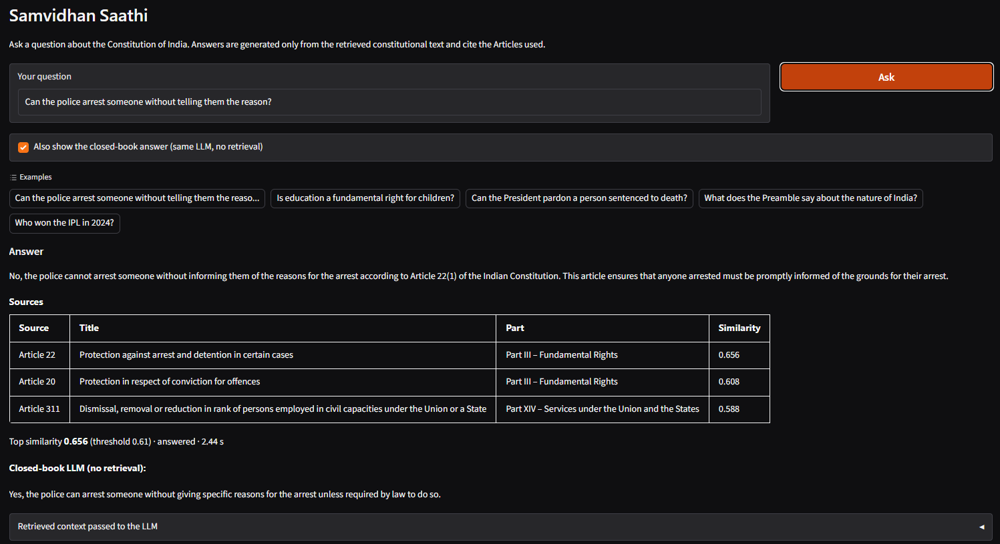
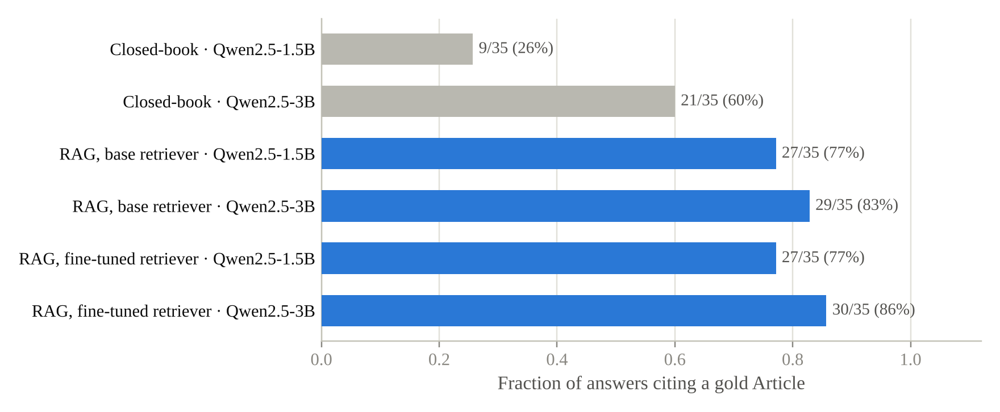
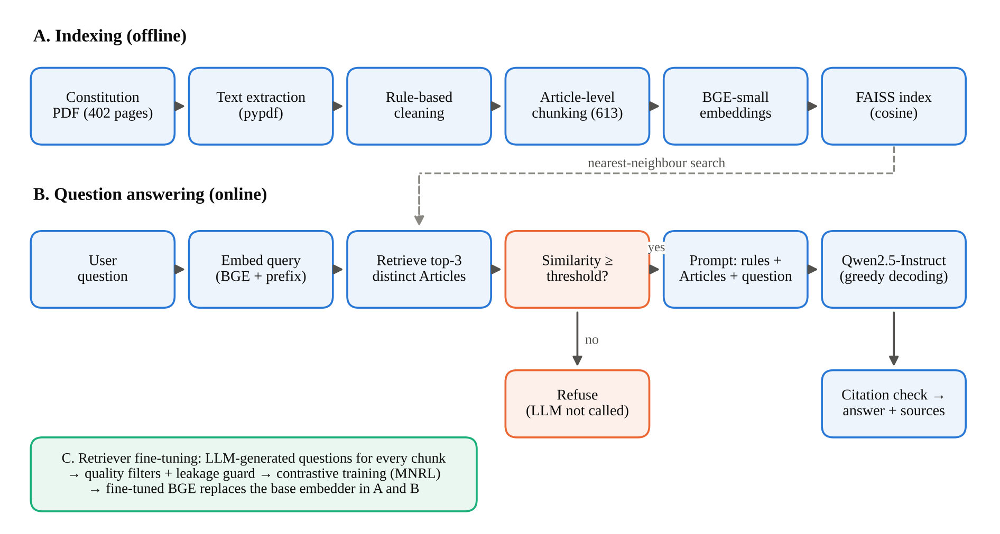
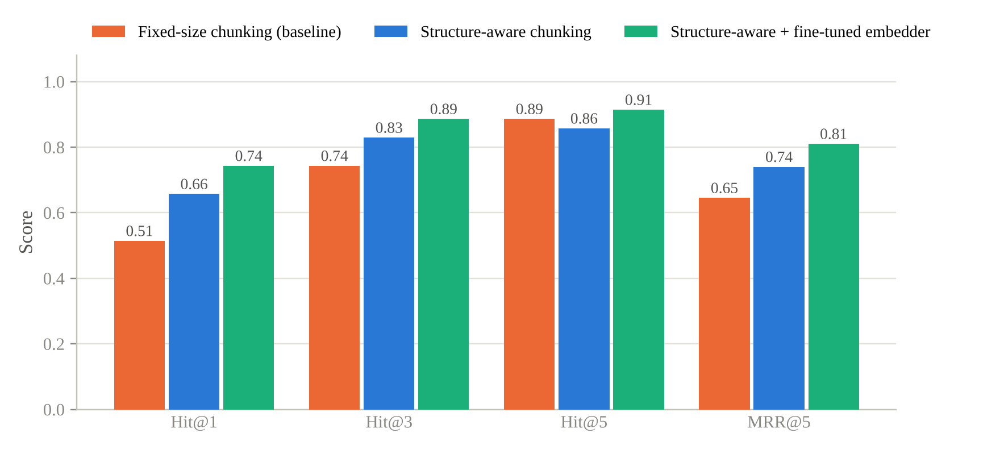

# Samvidhan Saathi

**Retrieval-Augmented Question Answering over the Constitution of India, with Article-level citations.**

Ask a question in plain English, for example *"Can the police arrest someone without telling them the reason?"*. Samvidhan Saathi finds the relevant Articles of the Constitution, answers only from that text, and names the Articles it used. If the Constitution doesn't cover the question, it declines instead of guessing.

Everything runs on a **free Google Colab T4 GPU**.

> Course project for **UCS748 – Generative AI**, Thapar Institute of Engineering and Technology, Patiala
>
> **Team:** Parth Verma (102495001) · Dhruv Garg (102315282) · Abhiranjan Sinha (102315263) · Harshdeep Jhakar (102315269)



---

## Why this project

Large Language Models write fluent answers, but they hallucinate and cannot show a source. For legal information a confident wrong answer is dangerous. In our tests, the same 1.5B model **without retrieval** said the police *can* arrest someone without giving reasons. Article 22(1) says the opposite.

Retrieval-Augmented Generation (RAG) fixes this: the model answers from retrieved constitutional text and cites it.

## Results

| What we measured (35 held-out questions) | Result |
|---|---|
| Answers citing a correct Article: closed-book 1.5B → RAG 1.5B → final system | **26% → 77% → 86%** |
| Top-1 retrieval: fixed-size → Article-level chunks → + fine-tuned embedder | **Hit@1 0.51 → 0.66 → 0.74** |
| Article coverage of the parsed Constitution | **395 / 395**, checked automatically |
| Off-topic refusal on the calibration set | **100%** separation, before and after fine-tuning |



## How it works



| Stage | Component |
|---|---|
| Parsing | `pypdf` |
| Chunking | One chunk per Article, with Part and section metadata (baseline: fixed 1,000-character windows) |
| Embeddings | `BAAI/bge-small-en-v1.5`, fine-tuned on synthetic constitutional questions |
| Vector search | FAISS `IndexFlatIP` (exact cosine similarity) |
| Generator | `Qwen/Qwen2.5-3B-Instruct` (compared with `Qwen2.5-1.5B-Instruct`), greedy decoding |
| Interface | Gradio |

**Key design decisions**

- **Each Article is one chunk.** Fixed-size chunking mixed about two Articles per chunk and cut 307 of 468 Articles apart. Article-level chunks keep legal meaning intact and make precise citation possible.
- **Validation built in.** A coverage test checks that every Article from 1 to 395 is parsed or explicitly omitted. It caught a real bug: footnotes placed mid-page had silently deleted 19 Articles.
- **Three safeguards against hallucination:** a calibrated similarity threshold (off-topic questions are refused without calling the LLM), a prompt that restricts the model to the retrieved text, and a citation check that flags Articles not in the context.
- **A fine-tuned retriever.** With no labelled data available, the LLM wrote two everyday-language questions per chunk. Quality filters and a leakage guard, which removes anything close to a test question, left 777 pairs. `bge-small` was fine-tuned with `MultipleNegativesRankingLoss` in 31 seconds.

## Experiments

**Retrieval** (Hit@k and MRR over the top 5 results)

| Configuration | Hit@1 | Hit@3 | Hit@5 | MRR@5 |
|---|---|---|---|---|
| Fixed-size chunking (baseline) | 0.514 | 0.743 | 0.886 | 0.645 |
| Structure-aware chunking | 0.657 | 0.829 | 0.857 | 0.740 |
| **Structure-aware + fine-tuned embedder** | **0.743** | **0.886** | **0.914** | **0.810** |



**End-to-end** (does the answer cite a correct Article?)

| Configuration | Gold Article in context | Correct Article cited |
|---|---|---|
| Closed-book · Qwen2.5-1.5B | – | 9/35 (26%) |
| Closed-book · Qwen2.5-3B | – | 21/35 (60%) |
| RAG, base retriever · 1.5B | 30/35 | 27/35 (77%) |
| RAG, base retriever · 3B | 30/35 | 29/35 (83%) |
| RAG, fine-tuned retriever · 1.5B | 31/35 | 27/35 (77%) |
| **RAG, fine-tuned retriever · 3B** | **31/35** | **30/35 (86%)** |

Fine-tuning brings more correct Articles into the context and ranks them higher. The 3B generator turns that evidence into correct citations more reliably.

## Run it yourself

1. Open `Samvidhan_Saathi_UCS748_Final.ipynb` in Google Colab and choose **Runtime → Change runtime type → T4 GPU**.
2. Download *The Constitution of India (English Version)* PDF from the Legislative Department website ([legislative.gov.in](https://legislative.gov.in)).
3. Choose **Runtime → Run all** and upload the PDF when prompted.
4. The last cell prints a public Gradio link for the live demo.

A full run takes about 20 minutes on a free T4, including the one-time download of the 3B model.

## Repository structure

```
samvidhan-saathi/
├── Samvidhan_Saathi_UCS748_Final.ipynb   # complete pipeline with outputs
├── README.md
├── requirements.txt
├── report/                                # project report (PDF)
├── presentation/                          # presentation slides (PDF)
└── figures/                               # charts, architecture diagram, demo screenshots
```

## Limitations and future work

- The test set has 35 questions, so small differences are indicative, not statistically conclusive.
- Everyday words still differ from the legal text: *Lok Sabha* is *House of the People* in the Constitution.
- Similar Articles for the Union, the States and local bodies compete (for example Article 110 vs 199).
- The Schedules are not indexed, and only English questions are supported.
- Next steps: a synonym glossary, hybrid BM25 + dense retrieval with a re-ranker, hard negatives from mirror provisions, and Hindi and Punjabi questions.

> This project explains what the constitutional text says. It is not legal advice.

## References

1. Lewis et al. (2020). *Retrieval-Augmented Generation for Knowledge-Intensive NLP Tasks.* NeurIPS.
2. Vaswani et al. (2017). *Attention Is All You Need.* NeurIPS.
3. Xiao et al. (2023). *C-Pack: Packaged Resources to Advance General Chinese Embedding* (BGE). arXiv:2309.07597.
4. Qwen Team (2024). *Qwen2.5 Technical Report.* arXiv:2412.15115.
5. Johnson, Douze & Jégou (2021). *Billion-scale Similarity Search with GPUs.* IEEE Transactions on Big Data.
6. Legislative Department, Government of India. *The Constitution of India* (2026, English Version).
